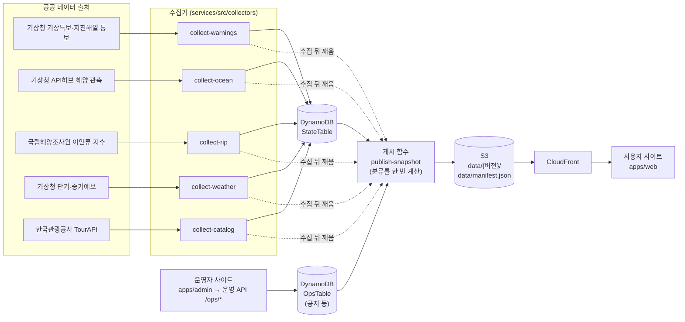

# 바라던 바다 V2

해변마다 바다 기상특보가 발효됐는지, 파고 측정이 제때 들어오고 있는지를 보여 주는 웹 서비스입니다. 바다에 가기 전에 공식 특보와 관측 상태를 한 화면에서 확인하려는 사람을 위해 만들었습니다.

> 최종 판단은 현장 통제와 안전요원 안내가 우선입니다.

- **사이트**: <https://baradun.app>
- **운영자 사이트 시연**: <https://admin.baradun.app/login/demo/> (예시 데이터만 보이는 시연 계정은 요청하면 드립니다.)
- 두 주소는 V2 운영 전환을 준비하고 있습니다. 전환 전에는 열리지 않거나 이전 버전이 보일 수 있습니다.
- **주요 스택**: TypeScript, Next.js 16 정적 내보내기, AWS Lambda·DynamoDB·S3·CloudFront(AWS CDK), Vitest, Playwright
- **해변 수**: 222곳(2026-11-17 기준 `data/beaches/`의 해변 파일 수)

## 하는 일과 하지 않는 일

서비스는 공식 출처로 확인할 수 있는 사실만 보여 줍니다. 바다에 들어갈지는 사용자가 현장 안내와 함께 판단합니다.

| 하는 일                                                                                                      | 하지 않는 일                                 |
| ------------------------------------------------------------------------------------------------------------ | -------------------------------------------- |
| 바다 관련 특보 5종(풍랑·강풍·태풍·폭풍해일·지진해일)의 발효 여부 확인                                        | 안전한 해변 추천, 입수 적합도·점수·레벨 산정 |
| 파고 측정이 90분 안에 들어왔는지 확인                                                                        | 공식 출입 통제 판단(현장 안내 확인을 권함)   |
| 해변을 `특보 없음`·`이용불가`·`판단불가` 중 하나로 분류하고 실제 사유(예: 풍랑주의보, 관측 지연)를 먼저 표시 | 확인하지 못한 상태를 `특보 없음`으로 표시    |
| 데이터 출처·관측 시각·단위 함께 표시                                                                         | 근거 없는 수치 기준이나 산식 만들기          |

`특보 없음`은 안전하다는 뜻이 아닙니다. 확인한 범위에서 특보가 없다는 뜻입니다.

## 빠르게 실행하기

비밀값이나 AWS 계정 없이 로컬에서 바로 실행할 수 있습니다. 개발 서버가 계약 예시 데이터로 더미 데이터를 만들고 화면에 '개발용 예시' 안내를 띄웁니다.

1. Node.js는 [.nvmrc](.nvmrc)의 버전을 씁니다.

   ```bash
   nvm use
   ```

2. 의존성을 설치하고 사용자 사이트 개발 서버를 실행합니다.

   ```bash
   npm install
   npm run dev
   ```

3. 브라우저에서 `http://localhost:3000`을 엽니다. 더미 데이터는 20분마다 새로 만들어집니다.

다른 데이터로 확인하려면 아래 명령을 씁니다.

| 명령                                  | 데이터                                                                                                                                                            |
| ------------------------------------- | ----------------------------------------------------------------------------------------------------------------------------------------------------------------- |
| `npm run dev`                         | 계약 예시로 만든 더미 데이터                                                                                                                                      |
| `npm run live`                        | 운영 게시본을 1분마다 확인해 새 버전만 내려받음. 공개 정적 파일만 읽음. `apps/web/.env.local`에 `BARADUN_DEV_DATA_ORIGIN=https://<운영 CloudFront 주소>`가 필요함 |
| `npm run dev:no-data -w @baradun/web` | 데이터 없음(로딩·오류 화면 확인용)                                                                                                                                |
| `npm run dev -w @baradun/admin`       | 운영자 사이트(`http://localhost:3100`). 로그인 화면의 '로컬 테스트 계정으로 들어가기'로 샘플 응답만 씀                                                            |

검사 명령은 루트에서 실행합니다.

```bash
npm run lint       # 전체 린트
npm run typecheck  # 전체 타입 검사
npm run test       # 워크스페이스 단위 테스트와 도구 테스트
npm run build      # 워크스페이스 전체 빌드
```

## 시스템 구성

수집기가 공공 API를 불러 사실을 저장합니다. 게시 함수는 해변 상태를 계산해 정적 파일로 올립니다. 사용자 사이트는 그 파일을 읽어 보여 줍니다. 해변 상태를 보여 주는 데에는 요청마다 도는 서버가 없습니다. 요청마다 도는 Lambda는 문의 접수(`/api/inquiries`)와 운영 API(`/ops/*`)이고 운영 API는 게시 미리보기 함수를 함께 부릅니다.



| 수집기             | 출처                                | 일정(KST)                                       |
| ------------------ | ----------------------------------- | ----------------------------------------------- |
| `collect-warnings` | 기상청 기상특보·지진해일 통보       | 매시 3·18·33·48분                               |
| `collect-ocean`    | 기상청 API허브 해양 관측            | 매시 10·40분                                    |
| `collect-rip`      | 국립해양조사원 이안류 지수          | 매시 12·42분(비수기에는 하루 1회)               |
| `collect-weather`  | 기상청 초단기실황·단기예보·중기예보 | 매시 15분(새 발표가 있을 때만 단기·중기를 부름) |
| `collect-catalog`  | 한국관광공사 TourAPI                | 하루 1회                                        |

일정은 [infra/lib/settings.ts](infra/lib/settings.ts)에 있습니다. 수집기는 수집을 마치면 게시 함수를 비동기로 깨웁니다. 게시 함수는 해변 상태를 계산해 `data/{버전}/`에 올린 뒤 `data/manifest.json`을 조건부 쓰기로 바꿉니다. 게시가 실패하면 manifest는 앞 버전을 그대로 가리킵니다.

## 저장소 구조

npm workspaces 모노레포입니다.

| 경로                     | 내용                                                                                                                                                                                  |
| ------------------------ | ------------------------------------------------------------------------------------------------------------------------------------------------------------------------------------- |
| `apps/web`               | 사용자 사이트. Next.js 정적 내보내기, 한국어·영어 문구 키, Storybook, Playwright E2E                                                                                                  |
| `apps/admin`             | 운영자 사이트. 정적 Next.js, Cognito 로그인, 운영 API로 문의·공지·게시·수집 상태 관리                                                                                                 |
| `services`               | Lambda 코드. `collectors`(수집), `core`(특보·관측 정규화와 저장), `publisher`(분류·게시), `inquiry`(문의 접수), `admin`(운영 API), `ops`(경보 알림)                                   |
| `packages/contracts`     | 화면과 서버가 함께 쓰는 JSON Schema, 생성된 TypeScript 타입, 계약 검사 도구                                                                                                           |
| `packages/design-tokens` | 두 앱이 함께 쓰는 디자인 토큰 값과 생성·검사 도구                                                                                                                                     |
| `infra`                  | AWS CDK 스택(S3, CloudFront, DynamoDB, EventBridge Scheduler, Cognito, IAM 권한 상한, 예산 알림)                                                                                      |
| `data`                   | 해변 원본(`data/beaches/` 해변 하나당 파일 하나), 부가 정보(`beach-meta.json`), 관측 대응표(`beach-coverage.csv`)                                                                     |
| `tools`                  | 해변 데이터 생성(`beaches`), 지도 파일 만들기(`map-tiles`), 게시 되돌리기(`republish`), 운영 정책 가져오기(`ops-policy`), 대체 코드 리뷰(`agy-review`), 한국어 문체 검사(`copy-lint`) |

경계는 이렇게 정했습니다.

- **`apps/web`·`apps/admin`·`services`는 서로를 가져오지 않습니다.** 공유는 `packages/contracts`로만 합니다. 화면과 서버가 같은 스키마를 기준으로 삼아야 해변 상태를 서로 다르게 해석하는 일이 생기지 않기 때문입니다. 예외는 디자인 토큰(`packages/design-tokens`) 하나입니다.
- **판단 규칙은 `services`에만 둡니다.** 특보 확인 45분과 관측 신선도(파고 90분)는 `services/src/core`(`warnings`·`observations`)가, 분류는 `services/src/publisher`가 계산합니다. 기준 시간 값은 `packages/contracts/src/judgment-policy.ts` 한 곳에 둡니다. 화면은 게시된 분류와 사유 코드를 문구로 바꾸기만 합니다.

## 설계 결정

### 확인하지 못한 상태를 판단불가로 분류

- **문제**: 특보 API가 응답하지 않거나 파고 측정이 늦게 들어오는데도 화면에 특보가 없는 것처럼 보이면, 사용자는 확인되지 않은 바다를 문제없다고 받아들일 수 있습니다.
- **선택**: 특보가 발효되면 `이용불가`, 특보 확인에 실패했거나 파고 측정이 90분을 넘기면 `판단불가`, 둘 다 아니면 `특보 없음`으로 분류합니다. 결측은 0이나 정상으로 바꾸지 않습니다. 가까운 측정소가 없으면 분류에는 영향을 주지 않고 값 자리에 '가까운 관측 없음'을 표시합니다.
- **결과**: 특보를 확인하지 못했거나 관측이 늦은 해변은 실제 사유(예: 관측 지연)와 함께 `판단불가`로 게시됩니다. 판정 코드는 [services/src/publisher/classify.ts](services/src/publisher/classify.ts)(분류), [services/src/core/warnings/confirmation.ts](services/src/core/warnings/confirmation.ts)(특보 확인 45분), [services/src/core/observations/freshness.ts](services/src/core/observations/freshness.ts)(파고 90분)와 각 폴더의 테스트. 기준은 Notion 결정 기록 11장(측정소 없음 B3·B4)입니다.

### 분류를 게시할 때 한 번만 계산

- **문제**: 화면과 서버가 각자 분류를 계산하면 같은 해변이 화면마다 다른 상태로 보일 수 있습니다.
- **선택**: 게시 함수가 게시할 때 한 번 계산하고 화면은 다시 계산하지 않습니다. 게시 파일의 모양은 `packages/contracts`의 JSON Schema로 정하고 TypeScript 타입을 스키마에서 생성합니다.
- **결과**: CI의 `npm run check:generated -w @baradun/contracts`가 생성된 타입이 스키마와 다르면 실패합니다. 해변 상태는 요청마다 계산하지 않으므로 사용자 사이트의 해변 화면은 CDN 캐시만으로 동작합니다.

### 정적 내보내기에서 CSP 지키기

- **문제**: Next.js 정적 내보내기는 요청마다 nonce를 만들 수 없습니다. 그래서 인라인 스크립트를 막는 CSP(Content Security Policy)를 그대로 쓸 수 없습니다.
- **선택**: 빌드 뒤 각 HTML의 인라인 스크립트 sha256 해시를 계산해 `<meta http-equiv="Content-Security-Policy">`로 넣습니다([apps/web/scripts/csp-meta.mts](apps/web/scripts/csp-meta.mts)). CloudFront 응답 헤더 CSP와 함께 걸려서 두 정책을 모두 통과한 스크립트만 실행됩니다.
- **결과**: `npm run check:csp -w @baradun/web`이 해시가 맞는지 검사합니다. 외부 스크립트 출처를 더할 때는 헤더 CSP([infra/lib/site/security-headers.ts](infra/lib/site/security-headers.ts)), E2E 정적 서버([apps/web/e2e/static-server.mjs](apps/web/e2e/static-server.mjs)), meta CSP를 함께 고쳐야 합니다.

### 월 US$1 예산 알림 안에서 운영

- **문제**: 개인 프로젝트라서 운영비가 월 예산 알림 기준(US$1)을 넘지 않아야 합니다. 2026-11-13 청구 내역을 보니 상시 무료 한도 밖에서 청구되는 항목은 S3 요청·저장과 CloudWatch 경보 지표 초과분이었습니다.
- **선택**: 사이트 배포 한 번에 앱마다 S3 PutObject 요청이 약 1,850건(약 US$0.008) 나갑니다. 그래서 main에 머지할 때마다 배포하지 않고 하루 한 번(05:17 KST) 정기 배포와 수동 배포만 합니다. CloudFront는 종량제를 유지합니다. 정액 Free 요금제는 직접 만든 응답 헤더 정책을 쓸 수 없어서 지금 보안 헤더를 유지할 수 없습니다.
- **결과**: 지금 구성의 추정 비용은 월 약 US$0.4~0.9입니다(Notion 결정 기록 D25-3 추정, 실제 청구액으로는 확인하지 않음). 자세한 내용은 [infra/README.md](infra/README.md#비용-방어-범위)의 '비용 방어 범위'에 있습니다.

### 인프라 자동 배포와 권한 상한

- **문제**: 인프라 배포를 손으로 하면 머지하지 않은 코드가 운영에 올라갈 수 있습니다. 반대로 CI에 넓은 권한을 주면 CI 역할을 탈취당했을 때 피해가 커집니다.
- **선택**: main CI가 성공하면 `deploy.yml`이 변경 세트를 만들어 판정합니다. 삭제나 교체가 없으면 바로 실행합니다. 삭제나 교체가 있으면 GitHub 승인을 기다립니다. 권한 상한(IAM Permissions Boundary)이 저장소와 다르면 멈추고 로컬 배포를 요구합니다. CI 역할은 스택 밖에 두고 IAM 쓰기 권한을 주지 않습니다. 그래서 스택 배포로 CI 역할의 권한을 넓힐 수 없습니다.
- **결과**: 머지한 코드만 운영에 올라갑니다. 판정과 배포 결과는 그 PR의 연결 이슈에 댓글로 남습니다. 자세한 판정 기준은 [infra/README.md](infra/README.md#main-머지-뒤-자동-배포-418)의 'main 머지 뒤 자동 배포'에 있습니다.

## 품질 관리

CI(`.github/workflows/ci.yml`)는 바뀐 영역만 골라 검사하고 모든 검사 결과를 `ci-ok` 하나로 모읍니다. `ci-ok`가 실패한 커밋은 배포하지 않습니다.

| 검사        | 내용                                                                                                                             |
| ----------- | -------------------------------------------------------------------------------------------------------------------------------- |
| 린트·타입   | 워크스페이스마다 ESLint와 `tsc`                                                                                                  |
| 단위 테스트 | Vitest(판단 규칙, 게시, 수집, 운영 API, 인프라 스택 템플릿과 권한 상한)                                                          |
| E2E·접근성  | 두 앱 모두 Playwright 스모크 테스트와 `@axe-core/playwright` 접근성 검사                                                         |
| 계약·데이터 | 생성 타입과 스키마 일치, 해변 파일 모양과 slug 규칙, 관측 대응표 정합성                                                          |
| 화면 규칙   | 디자인 토큰 대비·금지 색(`check:tokens`), 한국어·영어 문구 키 짝(`check:messages`), CSP 해시(`check:csp`)                        |
| 보안        | gitleaks 비밀값 검사, `npm audit`                                                                                                |
| 문체        | 커밋 메시지와 바뀐 화면 문구·문서 줄의 한국어 문체 검사(`tools/copy-lint`). 로컬 훅은 `git config core.hooksPath .githooks`로 켬 |

작업은 GitHub 이슈 하나에 브랜치 하나, PR 하나를 기본으로 합니다. 커밋은 성격(feat·fix·test·style 등)별로 나누고 `Rebase and merge`로 머지해 커밋 단위 이력을 main에 남깁니다. PR을 만들기 전에 코드 리뷰를 거칩니다. 자세한 규칙은 [AGENTS.md](AGENTS.md)에 있습니다.

## 배포와 운영

- **사용자·운영자 사이트**: 하루 한 번(05:17 KST) 정기 실행과 수동 실행으로 배포합니다. 지금 바로 배포하려면 `npm run deploy:prod`를 씁니다(gh 로그인 필요). 배포는 GitHub Actions가 OIDC 임시 키로 합니다.
- **인프라**: main에 머지하면 CI가 자동으로 배포합니다. 손으로 배포할 때는 최신 `origin/main` 작업 트리에서 `npm run deploy:infra`를 씁니다.
- **배포 멈추기**: 저장소 변수 `DEPLOY_PAUSED`를 `true`로 두면 정기 배포와 인프라 자동 배포가 멈추고 수동 배포(`npm run deploy:prod`)도 실패로 끝납니다.

운영 절차는 아래 문서에 있습니다.

| 작업                                    | 문서                                                                                       |
| --------------------------------------- | ------------------------------------------------------------------------------------------ |
| 점검 화면 켜기·끄기, 강제 업데이트      | [infra/README.md '점검·강제 업데이트'](infra/README.md#점검강제-업데이트)                  |
| 잘못 나간 게시 되돌리기                 | [infra/README.md '데이터 게시와 롤백'](infra/README.md#데이터-게시publish-snapshot와-롤백) |
| 해변 데이터 생성·숨기기, 개장 기간 출처 | [data/beaches/README.md](data/beaches/README.md)                                           |
| 문의 접수와 확인                        | [infra/README.md '데이터 문의 접수'](infra/README.md#데이터-문의-접수brd-63)               |
| 운영 경보                               | [infra/README.md '운영 경보'](infra/README.md#운영-경보brd-62)                             |

## 개인정보와 보안

- **문의 연락처 받기는 꺼져 있습니다.** `INQUIRY_CONTACT_ENABLED`가 `false`라서 화면은 이메일·사진 입력란을 숨기고 서버는 이메일이나 사진이 담긴 문의를 거절하며 CSP는 사진 버킷 주소를 허용하지 않습니다. 값은 화면·서버·인프라 세 곳에서 같아야 합니다. 다시 켜기 전에 아래 일을 마쳐야 합니다([services/src/inquiry/policy.ts](services/src/inquiry/policy.ts) 주석, 결정 기록 D13-3).
  - 문의 사진을 서버에서 다시 인코딩하기(BRD-116)
  - 익명 사진 업로드 비용 상한 두기(BRD-117, 2026-11-17 기준 열린 이슈)
  - 문의 이메일 삭제 자동화(BRD-119)
  - 개인정보 처리방침에 항목 추가
  - 고지 버전 올리기
- **문의 알림 메일에는 본문을 넣지 않습니다.** 메일에는 문의 ID, 유형, 접수 시각, 이메일 제공 여부만 들어갑니다.
- **분석 도구는 운영 빌드에만 들어갑니다.** Google Analytics는 쿼리·해시를 뺀 페이지 경로와 [정해 둔 기능 이용 이벤트](apps/web/src/lib/analytics/events.ts)만 보냅니다. 위치, 검색어 원문, 문의 본문, 해변 상태는 보내지 않습니다.
- **보안 응답 헤더**: HSTS(1년), `X-Content-Type-Options: nosniff`, `X-Frame-Options: DENY`, `Referrer-Policy`, `Permissions-Policy`를 CloudFront에서 보냅니다.

## 문서

| 문서                                                   | 내용                              |
| ------------------------------------------------------ | --------------------------------- |
| [AGENTS.md](AGENTS.md)                                 | 제품 규칙, 작업·커밋·PR·리뷰 규칙 |
| [docs/technical-writing.md](docs/technical-writing.md) | 문서 작성 규칙                    |
| [infra/README.md](infra/README.md)                     | 인프라 구성, 배포, 운영 절차      |
| [data/beaches/README.md](data/beaches/README.md)       | 해변 데이터 규칙                  |
| `apps/web/AGENTS.md`, `apps/admin/AGENTS.md`           | 앱별 규칙                         |

제품 요구사항과 결정 기록의 원본은 Notion입니다.

- [결정 기록](https://app.notion.com/p/3fa587f5074781529f6beb28440c39a8): 판단 모델(Rev.2.2), 데이터, 화면 원칙, 보안 가드레일
- [V2 아키텍처 기준 문서](https://app.notion.com/p/3fb587f5074781ed9fc0d52770e747e7): 시스템 구조, 모노레포 경계(17장, ADR 0001), 수집·게시 주기, 캐시, 오류 처리
- [AWS 운영 점검표](https://app.notion.com/p/402587f5074781438476fd8c816513b9): 계정 설정, 롤백 리허설 기록, 배포 점검
