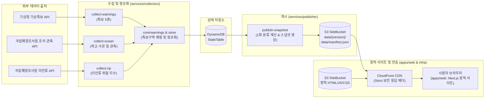

# 바라던 바다 V2

해변별 기상특보와 해양 관측값이 지금 확인되는지를 보여 주는 서비스입니다. 서비스는 확인 가능한 사실(바다 관련 특보 5종: 풍랑·강풍·태풍·폭풍해일·지진해일, 파고 측정 신선도)만 판단하며, 바다에 들어갈지는 사용자가 현장 안내와 함께 판단합니다. 공식 출입 통제는 판단하지 않으며, 안전한 해변을 추천하거나 입수 적합도를 판정하지 않습니다(원칙 G1·G2).

> 최종 판단은 현장 통제와 안전요원 안내가 우선입니다.

## 시스템 구성도

시스템은 **수집(Collector) → 정규화 및 상태 저장(Core/State) → 스냅샷 게시(Publisher) → 정적 사이트 배포(Web/CDN)** 단계로 동작합니다.



- **수집**: EventBridge Scheduler 일정에 따라 `collect-warnings`(기상특보 5종), `collect-ocean`(해양 관측), `collect-rip`(이안류 지수)이 주기적으로 실행됩니다.
- **정규화 및 상태 저장**: 수집된 원시 데이터는 `core`에서 검증 및 구역 매핑(해상 S1, 육상 L1)을 거쳐 DynamoDB `StateTable`에 저장됩니다.
- **게시**: 수집 완료 후 `publish-snapshot`이 비동기로 실행되어 해변 상태 분류(특보 없음 / 이용불가 / 판단불가)를 1회 계산하고(G1·G4), `data/{version}/` 및 `data/manifest.json`으로 S3에 원자적으로 게시합니다.
- **정적 웹**: Next.js 정적 내보내기(`output: 'export'`) 결과물과 스냅샷 데이터는 CloudFront CDN을 통해 사용자에게 서비스됩니다. 브라우저는 `manifest.json`과 해당 버전 스냅샷을 비동기로 읽어 렌더링하며 화면에서 분류를 재계산하지 않습니다.

## 저장소 구조

모노레포(`npm workspaces`)로 구성되어 있으며, 구조와 경계는 Notion 아키텍처 기준 문서 17장(ADR 0001)을 따릅니다.

| 경로 | 내용 |
|---|---|
| `apps/web` | Next.js 정적 사이트 (`output: 'export'`). 디자인 토큰, 다국어 문구 키, Playwright E2E, Storybook 포함 |
| `services` | 수집·게시·문의 처리 AWS Lambda (TypeScript). `core`(특보 정규화·스토어), `collectors`, `publisher`, `inquiry` |
| `packages/contracts` | 프론트엔드와 백엔드가 공유하는 단일 계약 (JSON Schema, TypeScript 생성 타입, 계약 검증 도구) |
| `infra` | AWS CDK (TypeScript) — S3, CloudFront, DynamoDB, EventBridge Scheduler, SNS, IAM 가드레일 (문서는 [infra/README.md](infra/README.md)) |
| `data/beaches` | 해변 목록 원본 (해변 하나당 파일 하나 `bXXXX.json`, 규칙은 [data/beaches/README.md](data/beaches/README.md)) |
| `data` | 해변 부가 정보(`beach-meta.json`), 커버리지 매트릭스(`beach-coverage.csv`), 이안류 대응 목록 등 |
| `tools/beaches` | 해변 데이터 생성·검증 도구 (공간 판정, 관측소 배정, 엑셀 파서) |
| `.github/workflows` | CI 워크플로(`ci.yml`) 및 프로덕션 사이트 배포(`deploy.yml`, GitHub Actions OIDC) |

## 로컬 실행 및 테스트

Node.js 버전은 [.nvmrc](.nvmrc)를 따릅니다(npm 포함). 루트 디렉터리에서 실행합니다.

```bash
npm install
npm run dev        # 개발 서버 (apps/web), 계약 예시 더미 데이터를 만들고 20분마다 갱신
npm run live       # 개발 서버 + 운영 snapshot 읽기 전용 미러 (apps/web/.env.local에 운영 주소 필요)
npm run build      # 워크스페이스 전체 빌드
npm run lint       # 전체 린트 검사
npm run typecheck  # 전체 TypeScript 타입 검사
npm run test       # 워크스페이스 전체 단위 테스트 + 해변 도구 테스트
```

### 개발 데이터 모드 (`apps/web`)

| 명령 | 데이터 소스 |
|---|---|
| `npm run dev` | 계약 예시 더미 데이터(`packages/contracts/examples`, 화면에 '개발용 예시' 안내 표시) |
| `npm run live` | 운영 snapshot을 1분마다 확인해 새 버전만 내려받음. 공개 정적 파일만 읽고 인증·비밀값 불필요 |
| `npm run dev:no-data -w @baradun/web` | 데이터 없음(로딩/오류 상태 화면 점검용) |

`npm run live` 사용 시 운영 CloudFront 주소를 `apps/web/.env.local`에 설정합니다:

```bash
echo 'BARADUN_DEV_DATA_ORIGIN=https://<운영 CloudFront>' >> apps/web/.env.local
```

### 워크스페이스별 주요 명령

각 패키지 디렉터리로 이동하거나 루트에서 `-w` 플래그로 실행합니다.

- **`apps/web`**:
  - `npm run storybook -w @baradun/web`: Storybook 컴포넌트 개발 서버 실행
  - `npm run check:tokens -w @baradun/web`: 디자인 토큰 대비 및 금지 색 검사
  - `npm run check:messages -w @baradun/web`: 한국어·영어 문구 키 짝 검사
  - `npm run check:csp -w @baradun/web`: 정적 HTML의 meta CSP 인라인 스크립트 sha256 해시 일치 검사 (BRD-118)
  - `npm run test:e2e -w @baradun/web`: Playwright E2E 및 axe-core 접근성 테스트 (빌드 산출물 필요)
- **`packages/contracts`**:
  - `npm run generate -w @baradun/contracts`: JSON Schema로부터 TypeScript 타입 생성
  - `npm run check:generated -w @baradun/contracts`: 생성된 타입 파일이 스키마와 일치하는지 CI 검증
  - `npm run check:beaches -w @baradun/contracts`: `data/beaches/*.json` 계약 모양 및 slug 규칙 검증
  - `npm run check:coverage -w @baradun/contracts`: `data/beach-coverage.csv` 매트릭스 정합성 검증
- **`services`**:
  - `npm run test -w @baradun/services`: 특보 정규화, 스냅샷 게시, 문의 처리 로직 Vitest 단위 테스트
- **`infra`**:
  - `npm run test -w @baradun/infra`: 스택 템플릿, IAM 권한 상한(Permissions Boundary), 가드레일 Vitest 테스트
  - `npx cdk synth` (`infra/` 경로): CloudFormation 템플릿 생성
  - `npx cdk diff` (`infra/` 경로): 배포된 스택과 로컬 변경 사항 비교
- **`tools/beaches`**:
  - `npm run test:beaches`: 해변 데이터 생성 도구 단위 테스트

## 운영 방법

> **주의**: 인프라 배포(`cdk deploy`)나 스케줄 변경, 롤백 등 실제 운영 환경 명령은 배포 권한과 승인이 있을 때만 수행하며, 로컬 작업 브랜치가 아닌 최신 `origin/main` 작업 트리에서 실행해야 합니다.

### 1. 점검 전환 (Maintenance Mode)

긴급 점검이나 서비스 중단이 필요할 때 사이트 화면 전체를 점검 안내로 전환합니다.

1. `services/src/publisher/policy.ts`의 `MANIFEST_SETTINGS.maintenance`를 `{ active: true, until: "<예정 시각 UTC ISO>" }`로 수정하여 main에 머지합니다.
2. 최신 `origin/main` 작업 트리에서 `npx cdk deploy`를 실행합니다 (Lambda 코드가 포함되므로 사이트 정적 배포로는 반영되지 않음).
3. 즉시 반영하려면 게시 함수(`PublisherFunctionName`)를 직접 호출하거나 다음 수집(15분 이내)을 기다립니다.
4. 상세 절차 및 점검 해제 방법: [infra/README.md#점검-켜기끄기](infra/README.md#점검-켜기끄기)

### 2. 데이터 게시 롤백 (Rollback)

잘못된 데이터가 게시되었을 때 이전 버전의 스냅샷으로 되돌립니다 (최근 48개 버전 보관).

1. 수집 일정이 새 버전으로 덮어쓰지 않도록 EventBridge Scheduler를 비활성화(`DISABLED`)하고 11분 대기합니다.
2. 되돌릴 버전을 S3에서 확인한 뒤 게시 Lambda를 롤백 이벤트로 직접 호출합니다:
   ```bash
   aws lambda invoke --function-name <PublisherFunctionName> \
     --cli-binary-format raw-in-base64-out \
     --payload '{"action":"rollback","version":"<되돌릴_스냅샷_버전>"}' /dev/stdout
   ```
3. 사이트의 `data/manifest.json` 반영을 확인하고 원인 조치 후 스케줄러를 다시 활성화합니다.
4. 상세 절차: [infra/README.md#데이터-게시publish-snapshot와-롤백](infra/README.md#데이터-게시publish-snapshot와-롤백)

### 3. 해변 추가 및 노출 숨김

해변 목록과 상세 페이지는 `data/beaches/`의 JSON 파일로 관리됩니다.

- **해변 추가**: `data/beaches/bXXXX.json` 파일을 생성하고 Beach 스키마와 slug 규칙을 준수하여 작성합니다. `data/beach-meta.json`에 메타(검색 별칭 및 운영 기간)를 추가하고, `npm run check:beaches -w @baradun/contracts` 및 `npm run check:coverage -w @baradun/contracts`로 검증한 뒤 PR로 머지합니다.
- **해변 노출 숨김**: 파일을 삭제하지 않고 JSON 안의 `"hidden": true`로 변경합니다. 목록·검색·즐겨찾기에서 숨겨지고 상세 페이지는 404가 됩니다.
- 상세 규칙 및 slug 작성법: [data/beaches/README.md](data/beaches/README.md)

### 4. 시즌 운영 기간 갱신

해수욕장 개폐장 기간 정보는 `info.season`을 통해 화면에 정보 배지로 표시되며(판단 분류에는 영향 없음), 매년 해수부 공식 발표 일정에 맞춰 갱신합니다.

1. `data/beach-meta.json`의 각 해변 `season` 항목 아래 해당 연도(예: `"2026"`)의 일정(`status`, `openDate`, `closeDate` 또는 미개장/미연결 시 `null`)을 갱신합니다. 지난 연도 일정으로 임의 추정하지 않습니다.
2. `npm run check:coverage -w @baradun/contracts`를 실행해 누락되거나 잘못된 형식이 없는지 검사합니다.
3. 게시 Lambda(`publish-snapshot`)가 `beach-meta.json`을 읽어 스냅샷 생성 시 반영합니다.
4. 상세 규칙: [data/beaches/README.md#함께-두는-파일-brd-59](data/beaches/README.md#함께-두는-파일-brd-59)

## 최근 보안 및 운영 주의 사항

origin/main 코드베이스에 적용된 보안 정책 및 운영 제약 사항입니다.

### 보안 응답 헤더 및 CSP meta 구조 (BRD-118)
- **헤더와 메타의 이중 보호**: CloudFront ResponseHeadersPolicy에서 엄격한 응답 헤더(`Strict-Transport-Security` 1년, `X-Content-Type-Options: nosniff`, `X-Frame-Options: DENY`, `Referrer-Policy`, `Permissions-Policy`)와 헤더 CSP(`script-src 'self' 'unsafe-inline'`)를 내보냅니다.
- **페이지별 인라인 스크립트 해시 주입**: Next.js 정적 내보내기는 요청 시점 Nonce를 쓸 수 없으므로, 빌드 후(`postbuild`) 각 HTML 내 인라인 `<script>` 내용의 sha256 해시를 계산해 `<meta http-equiv="Content-Security-Policy">`를 `<head>` 첫머리에 자동 주입합니다(`apps/web/scripts/csp-meta.mts`). 브라우저는 두 CSP를 모두 통과하는 스크립트만 실행합니다. 검증은 `npm run check:csp -w @baradun/web`으로 수행합니다.
- ⚠️ **외부 도메인 추가 주의**: 새 이미지 CDN이나 지도 타일 등 외부 도메인을 연동할 경우, `infra/lib/site/security-headers.ts`의 CSP 지시어(`img-src`, `connect-src` 등)를 함께 수정하고 `npm test -w @baradun/infra`를 통과해야 정상 동작합니다.

### 문의 이메일·사진 받기 단일 설정 (BRD-130)
- 문의 기능에서 개인정보(이메일) 및 사진 첨부를 허용할지 여부는 단일 설정 상수 `INQUIRY_CONTACT_ENABLED`(`services/src/inquiry/policy.ts`, `apps/web/src/lib/inquiry/form.ts`, `infra/lib/site/security-headers.ts`)로 일치시킵니다.
- **출시 기본값은 꺼짐(`false`)**:
  - 화면(`apps/web`)에서 이메일·개인정보 동의·사진 첨부 입력란이 숨겨집니다.
  - 서버(`services/inquiry`)에서 사진 업로드 양식 발급(`/api/inquiries/uploads`)을 차단하고, 이메일이나 사진이 포함된 문의 요청을 400으로 거절합니다.
  - 인프라(`infra`) CSP의 `connect-src`에서 사진 S3 버킷 origin이 제외됩니다.
- ⚠️ **다시 켜기 전 필수 선행 작업**: 개인정보 처리방침 항목 반영(BRD-116), 고지 버전 상향 및 운영 절차 점검(BRD-117, BRD-119)이 완료되기 전에는 켜지 않습니다.

### 문의 알림 및 본문 확인 절차 (BRD-120)
- 문의가 접수되면 운영자 SNS 알림 메일이 발송되지만, 메일함에 개인정보가 남지 않도록 **본문 요약, 이메일 주소, 사진 정보는 메일에 일체 포함되지 않습니다** (문의 ID, 유형, 접수 시각, 이메일 제공 여부 플래그만 전송).
- 운영자 콘솔(BRD-97) 도입 전까지 문의 상세 내용은 AWS 관리 콘솔 DynamoDB `InquiryTable`에서 파티션 키 `INQUIRY#<문의 ID>`(이메일은 `INQUIRY_EMAIL#<문의 ID>`)로 직접 조회하여 확인합니다. 상세 조회 방법은 [infra/README.md#문의-내용-확인운영자-콘솔-brd-97-도입-전](infra/README.md#문의-내용-확인운영자-콘솔-brd-97-도입-전)을 참고하세요.

## V1 대비 개선 근거

V1(404soonotfound/baradun) 대비 V2(baradun_v2)의 주요 아키텍처 및 제품 판단 개선 근거는 다음과 같습니다 (Notion Rev.2.2 사실 기반).

| 비교 항목 | V1 (baradun) | V2 (baradun_v2) | 사실 기반 개선 근거 및 기준 |
|---|---|---|---|
| **판단 범위** | 날씨·수온·파고 종합 점수 산출 및 입수 적합도/추천 지수 제공 시도 | 확인 가능한 사실(해상 특보 5종 발효 여부, 파고 측정 신선도 90분)만 판단. 적합도·추천·별점 산출 없음 | **원칙 G1·G2**: 서비스는 안전을 보장하지 않으며 통제 여부를 단정하지 않음. 복합 산식 배제 및 "현장 통제와 안전요원 안내 우선" 원칙 준수. |
| **관측 신선도** | 결측·지연 데이터를 0이나 정상으로 처리하거나 지연 상태를 명시하지 않음 | 파고 관측 시각이 90분을 초과하면 `판단불가` 처리 및 '관측 지연' 사유 배지 노출 | **결정 기록 11장 B3·B4**: 결측과 지연을 정상으로 왜곡하지 않음. 데이터 출처, 관측 시각, 단위를 화면에 투명하게 제공. |
| **분류 계산 시점** | 클라이언트 렌더링 시점 또는 API 요청마다 런타임 계산 | 게시 Lambda(Publisher)가 스냅샷을 생성할 때 1회만 계산 | **원칙 G4, ADR 0001**: 화면과 서버의 판단 불일치를 원천 차단하고 정적 CDN 캐싱 극대화. 화면은 사유 코드 문구 매핑만 수행. |
| **데이터 계약 (Contract)** | 비공식 인터페이스, 스키마 검증 없는 런타임 JSON 통신 | `packages/contracts`의 JSON Schema를 단일 진실 공급원(SSOT)으로 사용 | **ADR 0001**: 프론트/백엔드 경계 분리. TypeScript 타입 자동 생성 및 CI 단계 스키마 검증으로 불일치 방지. |
| **품질 및 검증 체계** | 단위 테스트 부재 또는 수동 확인 위주 | 전 워크스페이스 Vitest 단위 테스트 + Playwright E2E + axe-core 접근성 검사 + 보안/토큰 정적 검사 자동화 | 변경 시 CI(`ci.yml`)에서 단위 테스트, E2E, 접근성, CSP 해시, 토큰 대비, 다국어 문구 짝 검사를 필수 통과하도록 강제. |
| **인프라 및 비용 방어** | 동적 서버 인스턴스 의존, 세부 권한 경계 미흡 | Next.js 정적 내보내기(S3 + CloudFront) + IAM Permissions Boundary + 월 $1 예산 알림 | **원칙 G3, 아키텍처 11장**: 정적 호스팅으로 서버 유지 비용 및 장애 위험 최소화. 배포 역할 탈취 시에도 권한 상한 강제. |

## ADR 및 기준 문서

아키텍처 결정 기록(ADR)과 제품 요구사항의 유일한 원본은 Notion입니다. 작업 규칙은 [AGENTS.md](AGENTS.md)에 있습니다.

- **[Notion 결정 기록 (ADR / 결정 목록)](https://app.notion.com/p/3fa587f5074781529f6beb28440c39a8)**: 제품 판단 모델(Rev.2.2), 데이터 스키마, 화면 원칙, 보안 가드레일 등 전체 결정 목록
- **[Notion V2 아키텍처 기준 문서](https://app.notion.com/p/3fb587f5074781ed9fc0d52770e747e7)**: 시스템 구조, 수집·게시 주기, 캐시 정책, 에러 처리 기준
- **[Notion AWS 운영 점검표](https://app.notion.com/p/402587f5074781438476fd8c816513b9)**: 계정 설정, 롤백 리허설 기록, 배포 점검 절차

### 핵심 ADR 요약

| ADR | 제목 | 상태 | 핵심 내용 및 기준 Notion |
|---|---|---|---|
| ADR 0001 | 모노레포 폴더 구조와 경계 | 승인 | `apps/web`과 `services`는 서로 참조하지 않고 `packages/contracts`로만 소통. 분류 계산은 Publisher 1회 계산 (아키텍처 17장, E7) |
| ADR 0002 | TypeScript 및 Vitest 단일화 | 승인 | 백엔드 런타임 및 단위 테스트 도구를 TypeScript와 Vitest로 통일 (아키텍처 17장, ADR 0001에 통합 반영) |
